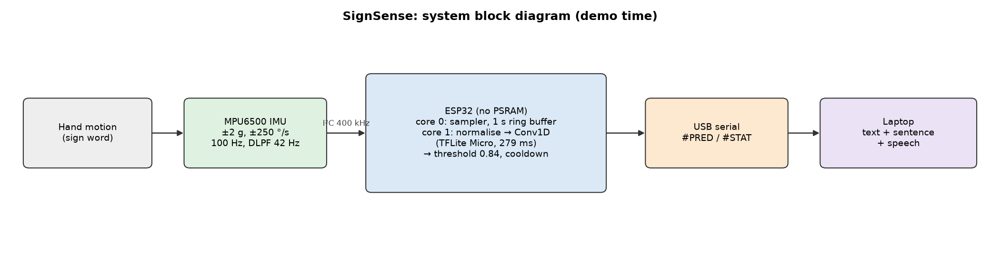
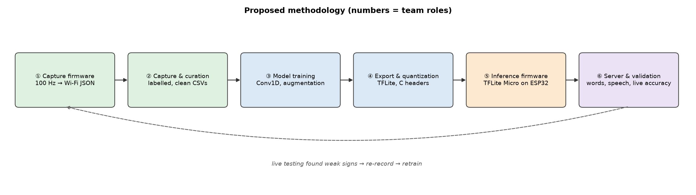
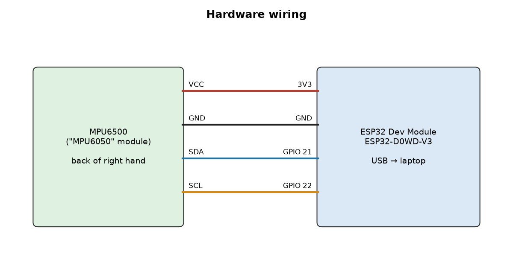
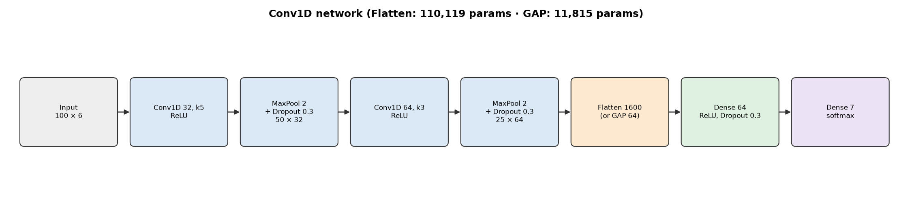
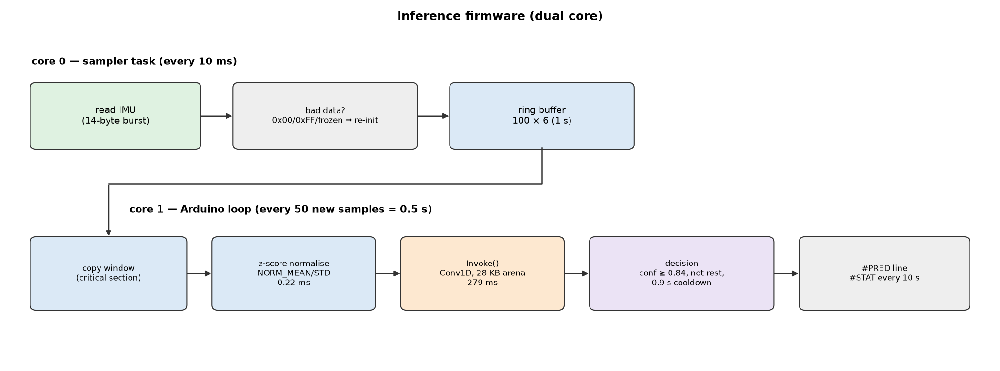
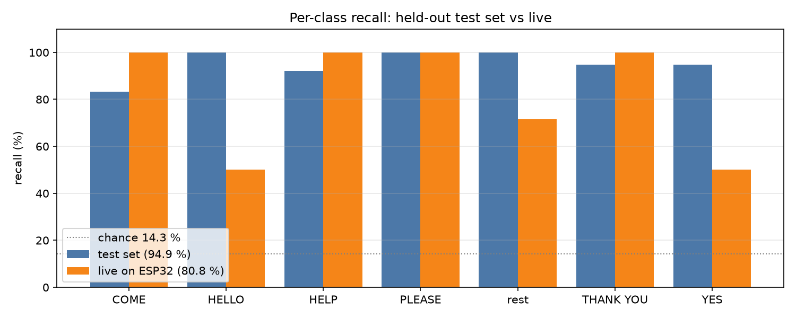
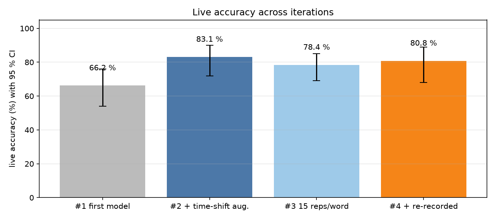
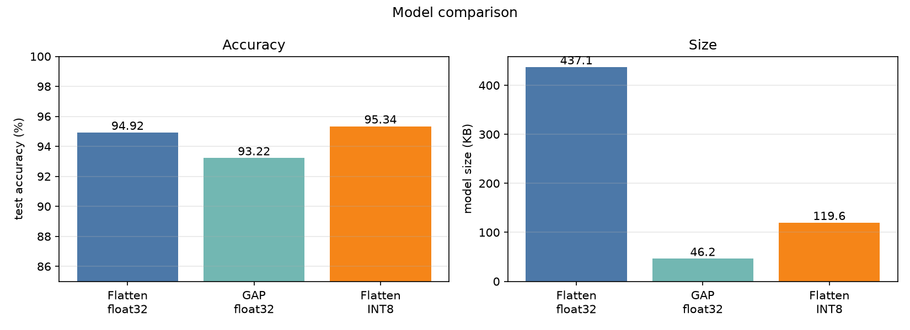

# SignSense: Real-Time Sign Language Word Recognition on an ESP32 Using a Single IMU and TinyML

A wearable that recognises six sign-language words from hand motion and turns them into text
and speech. One MPU6500/MPU6050 motion sensor sits on the back of the hand; an ESP32
microcontroller runs a 1-D convolutional neural network with TensorFlow Lite Micro, entirely
on the device.

**Project website:** https://signsense-vit.netlify.app/

**Words:** HELLO · THANK YOU · YES · PLEASE · HELP · COME (+ rest)

| Result | Value |
|---|---|
| Accuracy on held-out recordings | **94.92 %** (224 / 236 windows) |
| Accuracy in live use on the ESP32 | **80.77 %** (42 / 52 prompted trials) |
| On-device inference time | **279 ms** per `Invoke()` |
| Model size | 437 KB float32 · 120 KB INT8 (same accuracy) |
| Hardware | ESP32-D0WD-V3 (no PSRAM) + MPU6500 |

The README follows the review presentation outline; each section maps to one or more slides.

---

## 1. Motivation  *(1 slide)*

- Most hearing people do not know sign language, so deaf and hard-of-hearing signers often
  depend on an interpreter for everyday conversations.
- Camera-based translators need good lighting, a clear view of the hands, a powerful computer
  and a camera pointed at the user, which raises privacy concerns.
- Sensor gloves avoid the camera but usually need many sensors (one per finger) and a PC.
- **Goal:** a low-cost wearable that recognises common sign words on a ₹-level microcontroller,
  without a camera, a cloud connection or a PC doing the recognition.

---

## 2. Contemporary works — literature survey  *(2 slides)*

| # | Work | Approach | Strength | Limitation for our goal |
|---|---|---|---|---|
| [1] | Camgöz et al., CVPR 2020 | Video + Transformer (continuous SL translation) | Full sentences, high accuracy | Needs camera and GPU |
| [2] | Wu, Sun & Jafari, IEEE JBHI 2016 | Wrist IMU + surface EMG, 80 ASL signs | Real-time, wearable | Two sensor types; classification on a PC |
| [3] | Zhou et al., Nature Electronics 2020 | Stretchable yarn strain sensors on each finger, sign-to-speech | 660 ASL hand gestures, wireless | Custom fabricated sensors; recognition on a phone or PC |
| [4] | Wen et al., Nature Communications 2021 | Triboelectric smart glove + deep learning | Words and sentences | Many custom sensors; off-device processing |
| [5] | Ahmed et al., Sensors 2018 (review) | Survey of sensory gloves 2007–2017 | Shows the field's reliance on multi-sensor gloves | Few low-cost, on-device systems |
| [6] | Ordóñez & Roggen, Sensors 2016 | CNN + LSTM on wearable IMU data | Shows CNNs learn motion features from raw IMU data | Activity recognition, not sign language; not embedded |
| [7] | David et al., MLSys 2021 (TF Lite Micro) | Inference framework for microcontrollers | Neural networks in kilobytes of RAM | Framework only |
| [8] | Banbury et al., 2020 (TinyML benchmarking) | Benchmarks for ML on microcontrollers | Shows latency/memory limits of MCU ML | Not a sign-language system |
| [9] | techmiguel/gesture-recognition (GitHub) | ESP32-S3 + MPU6050 + Conv1D, 5 direction gestures | Fully on-device; our starting code base | Directions only; needs PSRAM; no live-accuracy study |

### Research gap and objective  *(1 slide)*

**Gap**
1. Camera systems need a camera, a GPU and a clear line of sight.
2. Glove systems use many sensors (one per finger) and send data to a PC or phone for recognition.
3. Few systems recognise sign *words* with **one** IMU and do the recognition **entirely on a
   low-cost microcontroller**, especially one **without external PSRAM**.
4. Most papers report only **offline** test accuracy. They rarely measure how accuracy changes
   when a person signs live, on prompt.

**Objectives**
1. Recognise 6 sign words + rest from a single back-of-hand IMU.
2. Run the complete model on a classic ESP32 (no PSRAM) with TensorFlow Lite Micro.
3. Reach ≥ 90 % accuracy on held-out data and measure live accuracy separately.
4. Measure on-device latency and memory, and compare float32 vs INT8 and Flatten vs GAP models.
5. Show the recognised word as text and speech on a laptop.

---

## 3. Proposed methodology — block diagram  *(1 slide)*

**System block diagram (what runs at demo time)**



**Development workflow (how the model was built; numbers = team roles, Section 11)**



The dotted arrow shows the iteration loop used in this project: live testing found weak signs,
which were re-recorded and retrained.

---

## 4. Sub-systems  *(1 slide, headings only)*

1. **Sensing & capture firmware**: MPU6500 driver, 100 Hz sampling, Wi-Fi streaming
2. **Data capture & dataset curation**: labelling, quality checks, offset correction, balancing
3. **Model training**: Conv1D network, augmentation, architecture comparison
4. **Model export & quantization**: TFLite float32 / INT8, C-array generation
5. **On-device inference firmware**: TFLite Micro, dual-core scheduling, decision logic
6. **Inference server & system validation**: live display, speech, guided tests, threshold tuning

Supporting diagrams:

| Hardware wiring | CNN architecture |
|---|---|
|  |  |



---

## 5. Database and performance metrics  *(1 slide)*

### Dataset (self-recorded)

| Item | Value |
|---|---|
| Sensor | MPU6500 (WHO_AM_I = 0x70), back of right hand |
| Channels | ax, ay, az (g, ±2 g) · gx, gy, gz (°/s, ±250 °/s) |
| Sampling | 100 Hz, digital low-pass ≈ 42 Hz |
| Sample (window) | 1 s = 100 timesteps × 6 axes = 600 values |
| Labelling | key press right after each sign; 3 time-shifted windows per press in the final round |
| Quality checks | Wi-Fi gaps, timing, saturation, "sign with no motion", "rest that moves", gyro offset |
| Classes | come, hello, help, please, rest, thank_you, yes |
| Clean windows | come 150 · hello 149 · help 191 · please 149 · rest 157 · thank_you 191 · yes 191 = **1,178** |
| Split (stratified, seed 42) | train 800 · validation 142 · **test 236** |
| Training set after augmentation | 5,600 (6 extra copies: ±0.5 s time shift, noise, ±10 % scale) |
| Earlier dataset (direction gestures) | up / down / left / right / rest, 730 windows |

### Performance metrics

| Metric | Formula |
|---|---|
| Accuracy | Σ TP / N |
| Precision | TP / (TP + FP) |
| Recall | TP / (TP + FN) |
| F1 score | 2PR / (P + R) |
| Cohen's κ | (p_o − p_e) / (1 − p_e) |
| 95 % CI | Wilson score interval |
| Live trial accuracy | correct trials / prompted trials (guided test) |
| Latency, memory | measured on device: `Invoke()` µs, tensor-arena bytes, free heap |

---

## 6. Results  *(3 slides)*

### Results 1: Classification accuracy

| | Test set (N = 236 windows) | Live on ESP32 (N = 52 trials) |
|---|---|---|
| Accuracy | **94.92 %** (95 % CI 91.3–97.1) | **80.77 %** (95 % CI 68.1–89.2) |
| Macro F1 | 95.11 % | 80.02 % |
| Cohen's κ | 0.941 | 0.776 |
| Chance level | 14.3 % | 14.3 % |



Test-set confusion matrix (rows = true, columns = predicted):

| | come | hello | help | please | rest | thank_you | yes |
|---|---|---|---|---|---|---|---|
| **come** | 25 | 0 | 0 | 0 | 0 | 0 | 5 |
| **hello** | 0 | 30 | 0 | 0 | 0 | 0 | 0 |
| **help** | 0 | 0 | 35 | 0 | 0 | 2 | 1 |
| **please** | 0 | 0 | 0 | 30 | 0 | 0 | 0 |
| **rest** | 0 | 0 | 0 | 0 | 32 | 0 | 0 |
| **thank_you** | 0 | 0 | 2 | 0 | 0 | 36 | 0 |
| **yes** | 2 | 0 | 0 | 0 | 0 | 0 | 36 |

### Results 2: Live accuracy and iterations



| Live test | Change made | Accuracy |
|---|---|---|
| #1 | first 6-word model | 66.2 % (43/65) |
| #2 | ±0.5 s time-shift augmentation | **83.1 %** (54/65) |
| #3 | same model, 15 repetitions per word | 78.4 % (80/102) |
| #4 | + re-recorded THANK YOU / YES / HELP | 80.8 % (42/52) |

Threshold sweep (live test #4): accuracy is flat at 80.8 % for confidence thresholds 0.50–0.89
and drops to 71.2 % at 0.95; the deployed threshold is **0.84**. Full report:
`artifacts/final_live_validation.md` / `.png`.

### Results 3: Model comparison and on-device performance



| Model | Test accuracy | Parameters | Size |
|---|---|---|---|
| Conv1D + Flatten, float32 (**deployed**) | 94.92 % | 110,119 | 437.1 KB |
| Conv1D + Global Average Pooling | 93.22 % | 11,815 | 46.2 KB |
| Conv1D + Flatten, INT8 | 95.34 % (99.58 % agreement with float32) | 110,119 | 119.6 KB |

| On-device (ESP32-D0WD-V3, 240 MHz) | Value |
|---|---|
| `Invoke()` latency | **279.1 ms** (min 279.08 · max 279.25) |
| Pre-processing | 0.22 ms |
| CPU load at 1 inference / 0.5 s | 55.8 % of one core |
| Sampling | 99.9 Hz, 0 samples lost |
| Tensor arena | 28 KB (internal RAM, no PSRAM) |
| Free heap at runtime | 186 KB |
| Flash used | 856 KB (27 %) |
| End of sign → word shown | ≈ 0.28–0.78 s |

---

## 7. Discussion  *(1 slide)*

- **Offline vs live gap (94.9 % → 80.8 %).** The test set comes from the same recording sessions
  as training. Live signs vary more in speed, size and timing. The largest single improvement,
  66 % → 83 %, came from **time-shift augmentation**. In the recordings every sign ended at the
  window's end, but the device classifies every 0.5 s, so live signs appear anywhere in the window.
- **Weak signs.** YES (a small fist nod) starts like COME and THANK YOU. HELLO (a repeated wave)
  can look like PLEASE's circular motion. With one sensor these differ only in small motion
  details. Signs with large, distinct movements (COME, HELP, PLEASE, THANK YOU) reach 100 % live.
- **Flatten vs GAP.** GAP was better for direction gestures (99.3 % vs 98.0 %) but worse for
  signs (93.2 % vs 94.9 %). Averaging over time throws away *when* motion happens, and that
  timing is what separates COME from YES.
- **INT8 quantization** cut size 3.65× with no accuracy loss. This leaves room for more classes
  or a larger model on the same chip.
- **Hardware findings.** The "MPU6050" module was an MPU6500 clone (WHO_AM_I 0x70) and was
  rejected by the standard library, so a register-level driver was written. A gyro calibration
  taken while the board was moving shifted the first dataset by ≈ 50 °/s. Curation now detects
  and removes this, and the firmware refuses to calibrate while moving.
- **Threshold.** Higher thresholds cut false triggers but miss weak signs; 0.84 balanced both.

---

## 8. Novelty and future scope  *(1 slide)*

**Novelty**
1. Sign-word recognition with **one IMU** and the complete CNN running on a **classic ESP32
   without PSRAM** (28 KB tensor arena in internal RAM).
2. **Live, prompted validation** with per-iteration accuracy, confidence intervals and a
   threshold sweep, in addition to offline accuracy.
3. **Time-shift augmentation matched to the inference stride**, which raised live accuracy from
   66 % to 83 % without new recordings.
4. Robust low-cost hardware handling: clone-sensor driver, motion-gated gyro calibration,
   automatic offset correction, and recovery from a loose sensor wire without a reboot.
5. Fully reproducible pipeline: `model_config.h` (normalisation, classes, quantization) is
   generated automatically, so the firmware and the training code always match.

**Future scope**
- Record training data in the same prompted way as live use, aiming for ≥ 90 % live accuracy.
- Add finger flex sensors to recognise handshapes and the alphabet.
- Deploy the INT8 model with ESP-NN optimised kernels to cut latency below 100 ms.
- Bluetooth Low Energy output to a phone app instead of a USB cable.
- More signers and more words; continuous sentence recognition with a sequence model.
- Browser dashboard (live word, sentence, confidences, device health).

---

## 9. Conclusion  *(1 slide)*

A single-IMU wearable with an ESP32 recognises six sign words plus rest **entirely on the
device**: **94.9 % accuracy on held-out data**, **80.8 % in live prompted use**, and **279 ms
inference** using **28 KB** of RAM on a microcontroller without PSRAM. Time-shift augmentation was
the key step for real-world use. Signs with distinct movements are recognised reliably, while
signs with very small motions (YES, HELLO) need more training data recorded under live
conditions, or additional sensors.

---

## 10. References  *(1 slide)*

1. N. C. Camgöz, O. Koller, S. Hadfield, R. Bowden, "Sign Language Transformers: Joint End-to-End Sign Language Recognition and Translation," *Proc. IEEE/CVF CVPR*, 2020.
2. J. Wu, L. Sun, R. Jafari, "A Wearable System for Recognizing American Sign Language in Real-Time Using IMU and Surface EMG Sensors," *IEEE J. Biomed. Health Inform.*, vol. 20, no. 5, 2016.
3. Z. Zhou *et al.*, "Sign-to-speech translation using machine-learning-assisted stretchable sensor arrays," *Nature Electronics*, vol. 3, 2020.
4. F. Wen, Z. Zhang, T. He, C. Lee, "AI enabled sign language recognition and VR space bidirectional communication using triboelectric smart glove," *Nature Communications*, vol. 12, 2021.
5. M. A. Ahmed, B. B. Zaidan, A. A. Zaidan, M. M. Salih, M. M. Lakulu, "A Review on Systems-Based Sensory Gloves for Sign Language Recognition State of the Art between 2007 and 2017," *Sensors*, vol. 18, no. 7, 2018.
6. F. J. Ordóñez, D. Roggen, "Deep Convolutional and LSTM Recurrent Neural Networks for Multimodal Wearable Activity Recognition," *Sensors*, vol. 16, no. 1, 2016.
7. R. David *et al.*, "TensorFlow Lite Micro: Embedded Machine Learning for TinyML Systems," *Proc. MLSys*, 2021.
8. C. Banbury *et al.*, "Benchmarking TinyML Systems: Challenges and Direction," arXiv:2003.04821, 2020.
9. B. Jacob *et al.*, "Quantization and Training of Neural Networks for Efficient Integer-Arithmetic-Only Inference," *Proc. IEEE/CVF CVPR*, 2018.
10. M. Lin, Q. Chen, S. Yan, "Network In Network," *Proc. ICLR*, 2014 (global average pooling).
11. P. Warden, D. Situnayake, *TinyML*, O'Reilly Media, 2019.
12. techmiguel, "gesture-recognition: ESP32-S3 + MPU6050 + TFLite Micro," GitHub repository, https://github.com/techmiguel/gesture-recognition.
13. InvenSense, *MPU-6500 Product Specification* and *Register Map*, rev. 1.x.

---

## 11. Individual roles  *(1 slide)*

| # | Sub-system / files | Member | Key contribution (one line for the slide) |
|---|---|---|---|
| 1 | Capture firmware: `esp32s3_capture.ino`, `imu.h` | **Nitigya Khaneja** | Register-level MPU6500 driver, 100 Hz fixed-rate sampling, JSON over Wi-Fi WebSocket, motion-gated gyro calibration |
| 2 | Data capture & curation: `capture_server.py`, `curate_dataset.py` | **Yashita Shrivastava** | 1,178 labelled windows (7 classes); automatic quality checks, gyro-offset correction and balancing |
| 3 | Model training: `train.py` | **Sneha Prasad** | Conv1D pipeline, Flatten vs GAP comparison, ±0.5 s time-shift augmentation → 94.9 % test accuracy |
| 4 | Export & quantization: `export_model.py` | **Arshiya Agarwal** | Float32 (437 KB) and INT8 (120 KB, 95.3 %) TFLite models; auto-generated C headers |
| 5 | Inference firmware: `esp32s3_inference.ino` | **Anusha Ghose** | TFLite Micro on a no-PSRAM ESP32 (28 KB arena), dual-core sampling, library fixes, `Invoke()` = 279 ms |
| 6 | Inference server & validation: `inference_server.py`, `analyze_live.py` | **Abhilash Sarma** | Sign → text/speech, guided live tests, confusion analysis, threshold tuning (0.84) → 80.8 % live |

Detailed explanation of each member's work: **[PROJECT_REPORT.md](PROJECT_REPORT.md), Section 11**.

---

## Appendix: project structure and how to run

```
gesture_project/
├── firmware/
│   ├── esp32s3_capture/      esp32s3_capture.ino, imu.h, secrets.h(.template)
│   └── esp32s3_inference/    esp32s3_inference.ino, imu.h, gesture_model.h*, model_config.h*
├── python/
│   ├── config.py             classes, words, window size, threshold (shared by all scripts)
│   ├── capture_server.py     record labelled windows over WebSocket
│   ├── curate_dataset.py     clean, fix offset, balance → data/clean/
│   ├── train.py              train Conv1D (Flatten / GAP), reports
│   ├── export_model.py       TFLite float32 + INT8, generates *.h files
│   ├── inference_server.py   live words + speech, guided test (--test)
│   ├── analyze_live.py       live confusion matrix, threshold sweep, latency
│   └── simulate_esp32.py     test the software without hardware
├── data/                     recorded CSVs (data_<class>.csv)
├── artifacts/                trained models and reports
├── logs/                     live-test and device-stat logs
├── docs/diagrams/            block diagrams and result charts (PNG + Mermaid source)
└── RESULTS.md                full accuracy calculations
```
\* generated by `export_model.py`.

**Hardware:** MPU6500 VCC→3V3, GND→GND, SDA→GPIO 21, SCL→GPIO 22. Arduino IDE board
"ESP32 Dev Module", Partition "Huge APP", PSRAM disabled, upload speed 115200.
Libraries: WebSockets (Markus Sattler), TensorFlowLite_ESP32 (patched for ESP32 core 3.x;
see Section 11.5).

```bash
pip install -r requirements.txt
cd python
python capture_server.py                 # 1-6 = signs, space = rest, r = auto-rest, z = undo, q = quit
python curate_dataset.py --no-balance
python train.py --arch flatten --augment --aug-copies 6 --max-shift 50
python export_model.py                   # then upload firmware/esp32s3_inference
python inference_server.py --speak --quiet --threshold 0.84 --port COM5
python inference_server.py --test --reps 8 --ready 2 --port COM5
python analyze_live.py ../logs/inference_test_*.csv --threshold 0.84
```
